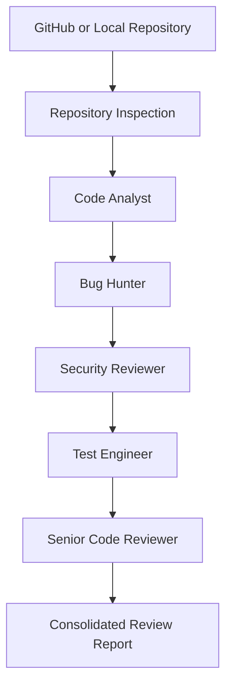

# CrewAI Code Reviewer

### Multi-Agent Code Review with CrewAI, Gemini, and Git

CrewAI Code Reviewer is an AI-assisted software engineering application that analyses Git repositories using five specialised AI agents.

Built with **CrewAI, Python, Gemini, Streamlit, and Git**, the system supports repository analysis, bug detection, security review, test assessment, and structured review reporting.

The project explores how specialised AI agents can collaborate through a sequential workflow to produce more organised and evidence-based code reviews.

> **Project type:** AI Engineering / Multi-Agent Systems / Developer Tooling  
> **Status:** Functional portfolio and learning project

---

## Overview

The application accepts either a public GitHub repository or a local Git repository.

Users can review an entire codebase, inspect the latest commit, or analyse uncommitted local changes.

The review process is divided across five agents, each responsible for a specific engineering concern.

Rather than relying on a single general-purpose reviewer, the system separates code understanding, bug analysis, security assessment, testing considerations, and final report consolidation.

### Core Capabilities

- Multi-agent code review using CrewAI
- Five specialised review agents
- Public GitHub repository analysis
- Local Git repository analysis
- Full repository and latest-commit review
- Uncommitted-change review for local repositories
- Bug and regression detection
- Security-oriented code analysis
- Test coverage and test-gap assessment
- Optional test execution with explicit consent
- Consolidated Markdown review reports
- Downloadable review results

---

## Multi-Agent Architecture

The system follows a sequential CrewAI workflow.



Each agent receives context from the preceding review stages.

The final reviewer consolidates the findings into a structured report, reducing duplication and identifying claims that need stronger evidence.

---

## Agent Responsibilities

| Agent | Engineering Responsibility |
| :--- | :--- |
| **Code Analyst** | Understands project structure, technology stack, modules, execution flow, and relevant code changes |
| **Bug Hunter** | Identifies potential runtime errors, logic problems, edge cases, unsafe assumptions, and regressions |
| **Security Reviewer** | Examines authentication, authorization, input validation, secret exposure, and potentially unsafe operations |
| **Test Engineer** | Reviews test configuration, existing coverage, missing cases, and regression risks |
| **Senior Code Reviewer** | Consolidates findings, removes duplicates, checks supporting evidence, and standardises severity levels |

### Why a Multi-Agent Design?

Different review tasks require different perspectives.

A bug-focused reviewer may identify logic problems, while a security-focused reviewer examines trust boundaries and potentially unsafe inputs.

Separating these responsibilities makes the review process easier to organise, inspect, and extend.

However, using multiple agents does not automatically guarantee better findings. Review quality still depends on repository context, model behaviour, and evidence verification.

---

## Repository Sources

### Public GitHub Repositories

The application accepts a public GitHub repository URL.

```text
https://github.com/owner/repository
```

Supported review modes:

- Full Repository
- Latest Commit

GitHub repositories are cloned into a temporary workspace for inspection.

The temporary clone is removed after the review workflow completes.

### Local Git Repositories

The application also accepts an absolute local repository path.

```text
/Users/username/projects/my-project
```

Supported review modes:

- Full Repository
- Latest Commit
- Uncommitted Changes

Local repository inspection uses read-only Git operations.

The normal review workflow does not automatically commit, push, reset, or modify the selected repository's source files.

Optional test execution is a separate operation and carries additional risks.

---

## Review Modes

| Mode | GitHub | Local Repository |
| :--- | :---: | :---: |
| Full Repository | Yes | Yes |
| Latest Commit | Yes | Yes |
| Uncommitted Changes | No | Yes |

### Full Repository Review

Analyses the repository as a whole.

Useful for understanding:

- Project structure
- Core modules
- Potential bugs
- Security concerns
- Testing practices
- Maintainability risks

### Latest Commit Review

Focuses on the latest commit and its potential impact.

The workflow examines:

- Commit metadata
- Changed files
- Git diffs
- Relevant surrounding code
- Possible regressions
- Security implications
- Missing tests

### Uncommitted Changes Review

Available for local Git repositories.

Reviews:

- Staged changes
- Unstaged changes
- Untracked files
- Working-tree diffs
- Relevant source context

This mode is designed to support developer self-review before committing.

---

## Tooling and Repository Inspection

The application provides custom tools through `tools.py`.

### Code Inspection

- List repository files
- Read source files
- Search repository code

### Git Inspection

- Inspect Git status
- Read commit information
- Identify changed files
- Examine Git diffs

### Test Assessment

- Detect Python test configuration
- Detect Node.js test configuration
- Identify available test commands
- Optionally run supported tests

The Git inspection tools are designed for read-only analysis.

---

## Test Execution Safety

**Repository test execution is disabled by default.**

```text
Run repository tests: OFF
```

The user must explicitly enable test execution and acknowledge the warning.

This restriction matters because test scripts can execute arbitrary code from the selected repository.

Enabling tests may run commands that access files, execute processes, or modify the local environment.

**Only run tests for repositories you trust.**

For untrusted repositories, use a properly isolated environment with restricted permissions, filesystem access, and network access.

The current application should not be treated as a complete sandbox for arbitrary code execution.

---

## AI Model and Orchestration

The application uses Gemini through CrewAI.

The five specialised agents share the configured Gemini model and execute their tasks sequentially.

### Request Throttling

The documented Crew configuration includes:

```python
max_rpm = 4
```

This conservative request limit helps manage API usage.

During execution, CrewAI may pause when the configured request limit is reached.

Review duration depends on repository size, model response times, and API availability.

---

## Final Review Report

The Senior Code Reviewer generates a structured Markdown report.

### Report Sections

1. Review Scope
2. Project Overview
3. Review Summary
4. Findings
5. Testing Assessment
6. Positive Observations
7. Recommended Fix Order

### Finding Structure

Individual findings may include:

| Field | Description |
| :--- | :--- |
| Severity | Relative importance of the issue |
| Category | Bug, security, testing, or maintainability |
| Location | File or relevant code location |
| Problem | Description of the suspected issue |
| Evidence | Supporting code or repository context |
| Impact | Potential consequence |
| Recommendation | Suggested correction |

The final report can be downloaded from the Streamlit interface.

**Important:** AI-generated findings are review suggestions. Developers should verify important findings before changing production code or making security-sensitive decisions.

---

## Technology Stack

| Technology | Purpose |
| :--- | :--- |
| Python 3.12 | Core application |
| CrewAI | Multi-agent orchestration |
| Google Gemini | Language model |
| Streamlit | User interface |
| Git | Repository and change inspection |
| uv | Dependency management |

---

## Getting Started

### Prerequisites

- Python 3.12
- Git
- uv package manager
- Gemini API key

### 1. Clone the Repository

```bash
git clone https://github.com/GaneshPokharel-tech/crewai-code-reviewer.git
cd crewai-code-reviewer
```

### 2. Install Dependencies

```bash
uv sync
```

### 3. Configure Environment Variables

Create a `.env` file in the project root.

```env
GEMINI_API_KEY=your_gemini_api_key
```

Never commit actual credentials.

### 4. Run the Application

```bash
uv run streamlit run main.py
```

Streamlit will display a local application URL, usually:

```text
http://localhost:8501
```

---

## Usage Examples

### Review a Public GitHub Repository

1. Select `GitHub Repository`.
2. Enter a public repository URL.
3. Choose `Full Repository` or `Latest Commit`.
4. Keep test execution disabled unless the repository is trusted.
5. Click `Review Repository`.
6. Review or download the generated report.

Example URL:

```text
https://github.com/owner/repository
```

### Review Local Uncommitted Changes

1. Select `Local Repository`.
2. Enter the absolute path of a Git repository.
3. Select `Uncommitted Changes`.
4. Click `Review Repository`.
5. Examine the generated findings before committing.

Example path:

```text
/Users/username/projects/my-project
```

---

## Project Structure

```text
crewai-code-reviewer/
│
├── main.py
├── crew.py
├── tools.py
├── pyproject.toml
├── uv.lock
├── .python-version
├── .gitignore
└── README.md
```

### Component Responsibilities

| File | Responsibility |
| :--- | :--- |
| `main.py` | Streamlit interface, repository selection, validation, execution, and report display |
| `crew.py` | CrewAI agents, tasks, model configuration, and sequential orchestration |
| `tools.py` | Code inspection, Git tools, test detection, and optional test execution |

This structure separates application interaction, agent coordination, and repository tooling.

---

## Security Considerations

The documented implementation includes controls intended to reduce risks during repository inspection:

- Validation of GitHub repository URLs
- Rejection of embedded URL credentials
- Repository-root restrictions for file access
- Path traversal checks
- Limits on large files
- Skipping binary files
- Exclusion of common generated directories
- Read-only Git inspection commands
- Subprocess execution using `shell=False`
- Explicit consent before optional test execution
- Cleanup of temporary GitHub clones

These controls reduce selected risks but do not guarantee complete isolation from malicious repositories.

### Code Privacy

Repository content may be supplied to the configured Gemini API during AI analysis.

Do not review confidential or proprietary code unless you are authorised to share that content with the model provider.

---

## Development Commands

### Python Syntax Check

```bash
uv run python -m py_compile main.py crew.py tools.py
```

### Git Status

```bash
git status
```

### Git Diff Validation

```bash
git diff --check
```

### Run Application

```bash
uv run streamlit run main.py
```

---

## Current Limitations

**GitHub Integration**

- Supports public repositories only
- No private GitHub authentication
- No pull-request-specific review
- No branch selection
- No arbitrary commit-range comparison
- No GitHub inline review comments

**Test Execution**

- Python pytest support
- Node.js npm test support
- Other test ecosystems are not automatically executed

**AI Review**

- Model outputs may contain false positives or missed issues
- Large repositories can increase execution time and API usage
- Findings require developer validation
- The application does not replace manual engineering or security review

---

## Future Improvements

Potential future development areas:

- Pull request analysis
- Branch and commit-range comparison
- Authenticated GitHub integration
- Structured JSON findings
- Review history
- Additional test frameworks
- CI/CD integration
- Automated pull request checks
- GitHub inline review comments

These are proposed improvements, not current features.

---

## Author

**Ganesh Pokharel**

AI Engineer | Python Developer

[GitHub](https://github.com/GaneshPokharel-tech) · [LinkedIn](https://www.linkedin.com/in/ganesh-pokharel-30786b192/)

---

*Built as a hands-on exploration of multi-agent orchestration, AI-assisted code analysis, and developer tooling.*
